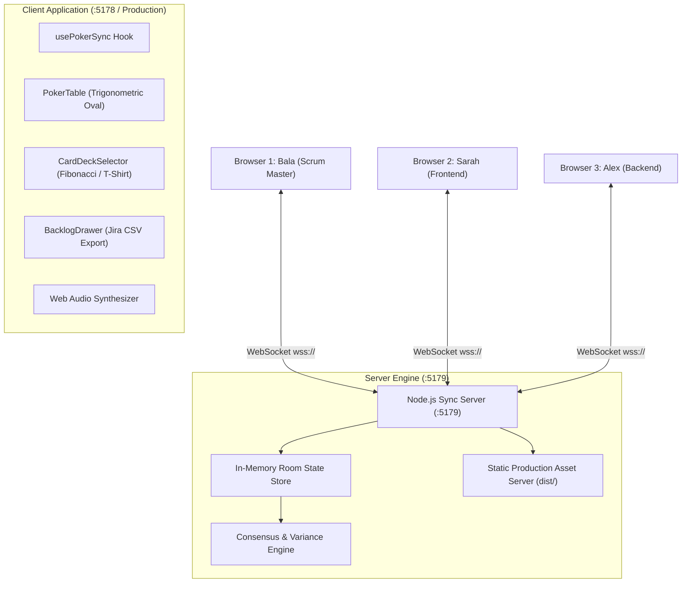

# 🃏 SprintPoker — Real-Time Agile Story Point Estimation

**Engineered by Balaji Palani** (Senior Scrum Master / Technical Agile Delivery Lead, CSM®, SAFe® 6 SSM)  
**Live Cloud URL:** [sprintpoker-gnel.onrender.com](https://sprintpoker-gnel.onrender.com)  
**Repository:** [github.com/layyzee/SprintPoker](https://github.com/layyzee/SprintPoker)  
**Live Portfolio:** [layyzee.github.io](https://layyzee.github.io)  
**Local Codebase:** [`/Users/layyzee/Downloads/SprintPoker`](file:///Users/layyzee/Downloads/SprintPoker)

---

## 📸 Production Verification Gallery

````carousel

<!-- slide -->

<!-- slide -->

````

---

## 🌟 What Was Built

### 1. Multiplayer Felt Poker Table ([`PokerTable.jsx`](file:///Users/layyzee/Downloads/SprintPoker/src/components/PokerTable.jsx))
* **Trigonometric Seating Ring:** Coordinates 5+ teammates smoothly around an emerald oval felt table with radial distribution.
* **Anti-Anchoring Bias:** Keeps votes face-down (`🂠`) with 3D gradients until the facilitator or team triggers reveal.
* **Live Status Telemetry:** Live headcount indicators (`X of Y Teammates Voted`) and active story card with collapsible acceptance criteria.

### 2. Smart Consensus & Outlier Analytics
* Automatic mathematical calculations upon card reveal:
  * **Unanimous Consensus:** Triggers procedural Web Audio chimes and canvas confetti celebration (`Consensus Reached! (5 pts) 🏆`).
  * **Divergence Warning:** Identifies outliers (`Min: 3 | Max: 8`) and prompts structured team debate (`💬 Divergent Estimates: Discuss!`).

### 3. Integrated Sprint Backlog Drawer ([`BacklogDrawer.jsx`](file:///Users/layyzee/Downloads/SprintPoker/src/components/BacklogDrawer.jsx))
* Real-time queue showing pending, active, and estimated stories with live point tallies.
* **"Accept Estimate & Next Story":** 1-click promotion that records velocity, marks story complete, and loads the next backlog item onto the table.
* **RFC 4180 Jira CSV Export:** Instant download for direct Jira sprint backlog import.
* **Confluence Markdown Table:** 1-click clipboard copy for sprint planning documentation.

### 4. Recruiter 1-Click Interactive Sandbox ([`RecruiterDemoBanner.jsx`](file:///Users/layyzee/Downloads/SprintPoker/src/components/RecruiterDemoBanner.jsx))
* Sub-header dock giving recruiters and hiring managers instant evaluation without needing multiple browsers:
  * `🎲 Simulate Split Votes`: Populates table with divergent estimates to test discussion prompts.
  * `🏆 Simulate Consensus`: Fills table with unanimous votes to trigger celebration.
  * `👁️ Reveal`: Flips cards with 3D animation.
  * `🔄 Reset`: Starts fresh estimation round.

### 5. Tactile Web Audio Synthesizer ([`sound.js`](file:///Users/layyzee/Downloads/SprintPoker/src/utils/sound.js))
* **\$0.00 footprint:** Zero audio files downloaded over the network.
* Uses native HTML5 Web Audio API to procedurally synthesize card clicks, card flips, harmonic consensus chords, and divergence warning tones.

---

## 🏗️ Technical Architecture & Specs



---

## 📊 Deployment & Portfolio Status

1. **GitHub Repository:** Created and pushed cleanly to [github.com/layyzee/SprintPoker](https://github.com/layyzee/SprintPoker).
2. **Cloud Blueprint:** [`render.yaml`](file:///Users/layyzee/Downloads/SprintPoker/render.yaml) created for 100% free tier hosting ($0.00/month).
3. **Live Portfolio Showcase:** Updated and pushed to [layyzee.github.io](https://layyzee.github.io) showcasing the full three-product SaaS suite:
   * **BalaBoard:** Real-time Miro retro alternative with AI clustering.
   * **BalaGPT:** Streaming GenAI productivity workstation with native SQLite.
   * **SprintPoker:** Real-time multiplayer Agile estimation table with Jira backlog export.
